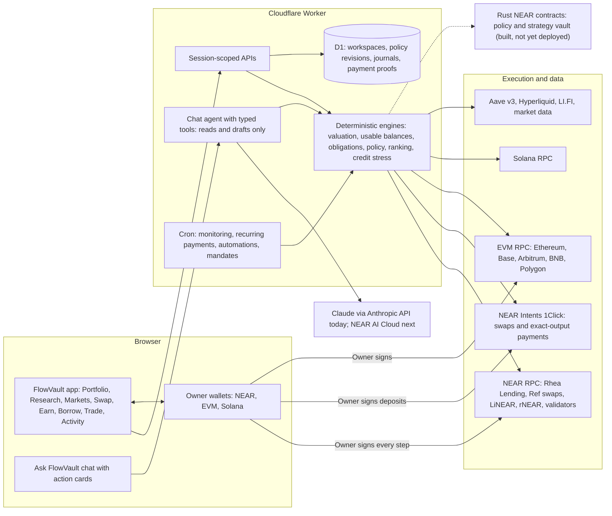
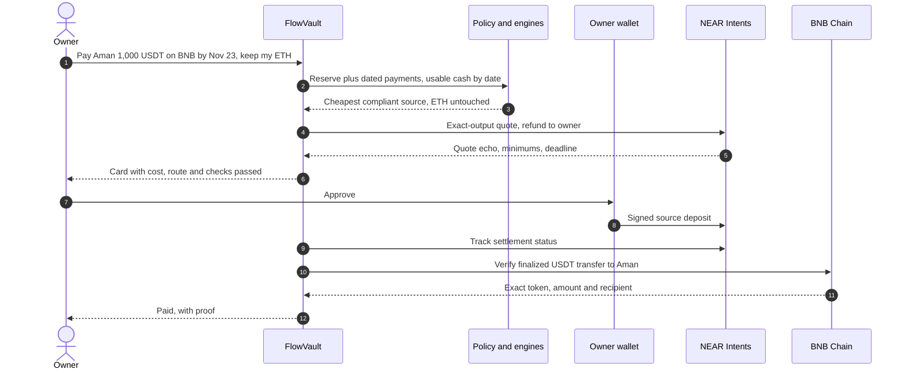
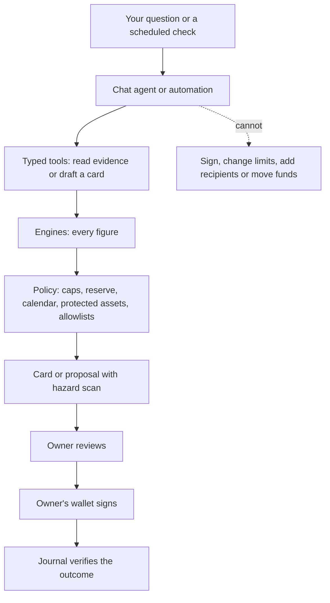
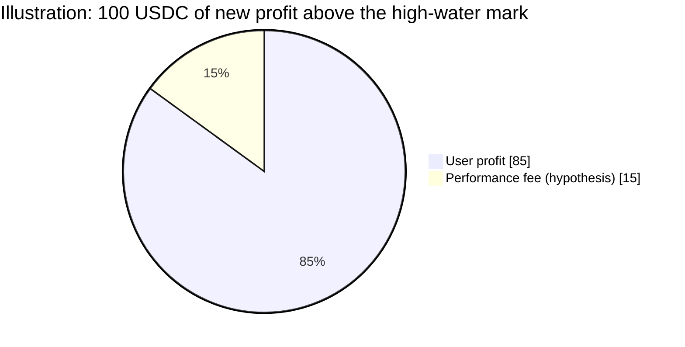

# FlowVault

### Your entire portfolio. One intelligent capital account.

FlowVault connects your wallets, earning positions and supported financial accounts into one capital account that follows your rules. Tell it what you need, for example *"pay Aman 1,000 USDT on BNB by the 23rd without touching my ETH"*. It works out where the money can come from, compares the routes, shows the cost and risk, and carries the plan you approve through to a verified result. Built on NEAR, with NEAR Intents for cross-chain settlement.

**Live app:** _link added at deployment_ · **Demo video:** _link added at submission_ · **Try it without a wallet:** [Demo Mode](#16-try-it--get-started)

> **Project history:** This project reuses the name and domain of an earlier hackathon-winning submission. The previous submission was a different product. The implementation, functionality, and architecture presented here were developed independently for the NEAR Hackathon.

---

## Contents

1. [Project identity](#flowvault) · 2. [The problem](#2-the-problem) · 3. [The core insight](#3-the-core-insight) · 4. [The solution](#4-the-solution) · 5. [System architecture](#5-system-architecture) · 6. [Explain it simply](#6-explain-it-simply) · 7. [Competitive differentiation](#7-competitive-differentiation) · 8. [Core mechanisms](#8-core-mechanisms) · 9. [The intelligence and decision layer](#9-the-intelligence-and-decision-layer) · 10. [User value and experience](#10-user-value-and-experience) · 11. [Business model](#11-business-model) · 12. [Technical significance](#12-technical-significance) · 13. [Why this works](#13-why-this-works) · 14. [Executive summary](#14-executive-summary) · 15. [Roadmap](#15-roadmap) · 16. [Try it](#16-try-it--get-started) · 17. [Implementation evidence](#17-implementation-evidence) · 18. [Developer operations](#18-developer-operations) · 19. [Limitations and disclaimers](#19-limitations-and-disclaimers)

---

## 2. The problem

Your money is everywhere.

Some of it sits in wallets. Some is earning yield in DeFi. Some is staked, locked in lending positions or held on exchanges. Different chains, different protocols, different interfaces.

**Your capital is fragmented, even when your financial decisions aren't.**

Imagine you need to pay someone **$1,000 USDT on BNB**. You have enough wealth to cover it. But your stablecoins are on another chain, your ETH is earning yield, and your other positions have withdrawal periods.

Do you sell? Withdraw? Borrow? Bridge? Which assets should you touch? What does each option actually cost? And will paying this bill leave enough for the rent that's due next week?

Today, you're the one connecting all those dots, and the tools don't help:

- **Portfolio trackers** show your net worth, but net worth isn't spendable. They can't tell you what you can actually use by a given date without breaking a reserve or missing an exit window.
- **Wallets, swaps and bridges** each perform one step. You still plan the route, size every leg and check that the money actually arrived.
- **Lending and staking apps** each show their own silo. None of them knows about your bills, your other positions, or the assets you've decided never to sell.
- **AI chat assistants** turn a sentence into a transaction, but the safety of that transaction rests on the model getting it right.

This matters because mistakes cost real money: an unnecessary sale, a loan at the wrong health factor, a withdrawal that misses a deadline, a payment that "succeeded" but never reached the recipient.

## 3. The core insight

**Every financial decision is a constrained choice against your own rules and your own calendar.**

The number that decides "can I pay this?" isn't net worth. It's **usable capital, by date, under your rules**: what's left after your reserve and your scheduled payments, counting only exits that complete in time, and never touching the assets you've protected.

Once that number exists, money decisions become comparable. Paying from idle cash, withdrawing from a lending pool, selling an approved asset or borrowing against collateral are all answers to the same question, and each can be ranked by what it costs you by the date that matters.

There's a second insight about authority: **the AI drafts, deterministic engines decide, and the owner signs.** A model can understand a request, but every figure comes from an engine, every action passes your policy, and nothing moves without your wallet's signature.

## 4. The solution

FlowVault is a **policy-driven capital orchestration platform**. Every action, whether a swap, a supply, a stake, a payment or a trade, runs through the same five layers:

| Layer | What it does | In this build |
| --- | --- | --- |
| **Observe** | Understands what you own, where it lives, what it earns and how much you can actually access, counted once. | Portfolio across NEAR, EVM chains and Solana; tokens, lending, staking, debt and NFTs; freshness and coverage shown; unknown values are never treated as zero. |
| **Configure** | You define how money should behave: reserve, scheduled payments, per-action and daily caps, protected assets, approved venues and recipients, borrowing limits. | Risk & permissions with numbered revisions; Scheduled payments; the policy is checked again when an action is prepared, so a stale approval can't slip through. |
| **Decide** | Evaluates liquidity and compares withdrawals, swaps, sales and eligible borrowing against your rules. | Bigint engines for valuation, usable balances, ranking by net-to-date and stress-tested credit; the chat drafts cards from those engines' figures. |
| **Execute** | Builds the exact transactions and hands them to your wallet, one reviewed step at a time. | NEAR wallet signing (MyNearWallet, Meteor), EVM and Solana wallets; Rhea, NEAR Intents, staking, Aave v3, LI.FI and Hyperliquid paths. |
| **Account** | Tracks every transaction and reconciles what actually happened. | Wallet journal with prepared → submitted → confirmed / partial / failed / unknown states; a payment is "paid" only after the recipient's transfer is proven on the destination chain. |

Capital orchestration isn't only about getting money out. FlowVault also helps put surplus to work (supply, staking, strategies), keeps watching it once deployed (monitoring, automations, alerts), and lets you pre-authorize narrowly scoped actions through signed mandates.

## 5. System architecture



| Component | Role |
| --- | --- |
| **App** | React interface (Next.js-compatible, built with vinext on Vite) served from a Cloudflare Worker. Cmd/Ctrl+K command bar (`swap 1 NEAR to USDC`, `buy RHEA`). |
| **APIs** | 44 API groups and 65 route handlers, each scoped to a session and a workspace (personal or Demo). |
| **Engines** | Pure TypeScript with bigint base units (USDC 6 decimals, NEAR 24). Shared by every screen, the chat, automations and the cron, so all of them show the same figures. |
| **Journal** | D1 tables for workspaces (revision-checked), wallet attempts and hashes, policy ledger and daily budgets, payment plans, destination proofs and locks. |
| **Chat agent** | Ask FlowVault: typed, schema-validated tools that read evidence or draft non-executable cards. |
| **Cron** | Advances recurring payments, runs monitoring, due automations and mandates. Reads and proposes; never signs. |
| **Contracts** | `contracts/policy` (rules, proposals, approval, revocation) and `contracts/vault` (NEP-141 shares, queued deposits, FIFO redemptions, high-water-mark fees, bounded Rhea authority). |

## 6. Explain it simply

**The analogy:** FlowVault is a personal treasurer with your rulebook in hand. The treasurer knows every account you have, every bill coming up and every rule you've set: "always keep $2,000 aside", "never sell my ETH", "no single move over $5,000". When you ask for money, they come back with options, the cheapest one first, and they never sign the cheque themselves.

**The end-to-end journey:**

1. **Connect your wallets.** NEAR, Ethereum/Base/Arbitrum and Solana. FlowVault reads every token, lending position, staking position and debt it can verify, and counts each one once.
2. **Set the rules.** A $2,000 reserve. Scheduled payments: studio rent, rent to Aman, software, payroll. Your ETH is protected. Caps of $5,000 per action and $8,000 per day.
3. **Ask.** *"Can I pay 1,000 USDT on BNB by Nov 23 without touching my ETH?"*
4. **FlowVault decides.** It holds back the reserve plus every payment due in the horizon, finds the surplus, compares paying from idle cash against withdrawing from Rhea, and leaves ETH alone. Every figure comes from the engines.
5. **You review.** The card shows the route, the expected amount received, fees, gas and the policy checks it passed.
6. **You sign.** Your wallet signs each step. FlowVault prepares the transactions; it never holds your keys.
7. **FlowVault accounts.** It watches the deposit, the cross-chain settlement and the recipient's transfer on BNB, and marks the payment paid only when that transfer is proven.



## 7. Competitive differentiation

| Approach | What it does well | Where it stops | FlowVault |
| --- | --- | --- | --- |
| **Portfolio trackers** | Show everything you own in one place | Net worth only; nothing about what's spendable by a date, and no action | Separates net worth, cash now, withdrawable by date, borrowing headroom and committed capital, and acts on them |
| **Wallets, swaps and bridges** | Execute one step well | You plan the route, size the legs and check delivery yourself | Plans multi-source, multi-chain routes, sizes each leg and verifies the result on the destination chain |
| **Lending and staking apps** | Deep single-protocol features | Blind to your bills, other positions and protected assets | Every supply, borrow and stake is checked against your reserve, calendar and rules; collateral is off by default |
| **AI chat assistants** | Natural-language convenience | The model's output decides what gets signed | The model only drafts cards. Engines supply every figure, the policy gates every action, and payment recipients come only from your saved list |
| **All-in-one terminals** | Many tools on one screen | The tools don't share a plan, a policy or an outcome | One spine, Observe → Configure → Decide → Execute → Account, behind every action |

**The fundamental advantage:** FlowVault isn't a collection of actions. It's a capital account with a policy and a calendar, and every action is a decision made against them, then proven after the fact.

## 8. Core mechanisms

Each mechanism below goes from the intuition to the implementation, with its status.

### 8.1 One capital account
*Intuition:* see everything once, and know what's actually usable.
*Implementation:* wallet and position reads across NEAR (tokens, Rhea, native, LiNEAR and rNEAR staking), EVM chains and Solana, plus whole-wallet EVM reads through Zerion when enabled. A card per wallet plus totals by network and by wallet. The headline never goes blank: a partial read shows "≥ known subtotal", a failed read keeps the last good figure with its time, and accounts come in only through their own wallet. **Built.**

### 8.2 Dated obligations and the reserve
*Intuition:* money has jobs and due dates.
*Implementation:* scheduled payments (amount, token, chain, recipient, due date, recurrence) plus a reserve form the **holdback**. Surplus is what's left above it. Withdrawable-by-date counts only exits that finish in time. Live obligations in other tokens get conservative USDC reservations, and unknown FX blocks automation. **Built.**

### 8.3 Capital policy (Risk & permissions)
*Intuition:* your rules decide, not the agent.
*Implementation:* per-action and daily caps, a maximum moving cost, protected assets (never sell or pledge), venue, method and recipient allowlists, and borrowing permissions per asset, saved as numbered revisions. Every action is evaluated when it's prepared and again before the wallet handoff. Approval cards show one hazard scan listing every check that ran. **Built.** A Rust policy contract mirrors these rules on-chain (14 tests). **Built, not yet deployed.**

### 8.4 Cash access and cross-chain payments
*Intuition:* state the outcome, and let FlowVault find the route.
*Implementation:* payment plans compare idle cash, Rhea withdrawal and approved sales. They request **exact-output** NEAR Intents quotes so the recipient gets the exact amount, and check the quote echoes the request. Payments settle to Base, Arbitrum, BNB (USDT) and Ethereum (USDC/USDT). A source deposit being confirmed is not "paid": paid requires an independently verified, finalized transfer of the exact token and amount to the recipient. **Built; owner-funded run pending.**

### 8.5 Collect and send, and multi-wallet funding
*Intuition:* pay from wherever the money is.
*Implementation:* choose what the recipient should get (for example 3 USDC on Base), and FlowVault proposes the cheapest mix of your holdings across chains after gas and fees. Each leg is a NEAR Intents swap straight to the recipient, signed by the wallet that holds it, with a per-leg ledger and recovery. Sources include NEAR, Ethereum, Base, Arbitrum, BNB, Polygon and Solana USDC. No all-or-nothing atomicity is claimed. **Built.**

### 8.6 Earn, borrow and stake
*Intuition:* put surplus to work without endangering the calendar.
*Implementation:* live Rhea markets with in-app supply, withdraw, borrow, repay, and add or release collateral. Health is stress-tested in protocol units, and new debt needs explicit approval. Aave v3 on Ethereum, Base and Arbitrum has venue-local capacity. Swap-then-supply lets you supply a market you don't hold in one flow. Staking (native validators, LiNEAR, rNEAR) is resumable, including funding it from USDC or ETH on other chains. **Built.**

### 8.7 Markets and trading
*Intuition:* trade from the same account, under the same rules.
*Implementation:* a market screener with token pages, candles, plain-language risk signals and a 0–100 spot safety score. Any listed token can be bought or sold through LI.FI from your own wallets. Hyperliquid perpetuals use a trade-only agent under a signed mandate, and unrealized gains never count as cash. Trades fail closed when costs are unknown. **Built; the perps agent needs owner setup.**

### 8.8 Strategy vaults and mandates
*Intuition:* researched strategies anyone can allocate to, with defined entry, limits and exit.
*Implementation:* a pooled vault contract (NEP-141 shares, queued deposits, FIFO fixed claims, high-water-mark fee crystallization on owner NAV reports, bounded Rhea authority, pause and shutdown) with holder and curator views and wallet-signed deposit, redeem, claim and settle steps (42 tests). Autonomous mandates are NEP-413-signed terms with deterministic checks, a kill switch and a freeze on uncertain operations. The cron prepares plans for the owner to sign. **Built, not yet deployed or audited.**

## 9. The intelligence and decision layer

**Engines decide.** Valuation, usable balances, the holdback, net-to-date ranking and stressed credit capacity are pure, deterministic functions. Every screen, the chat, automations and the cron call the same ones, so a figure never differs between places.

**Ask FlowVault understands.** The chat reads your balances, limits, scheduled payments, markets and quotes through typed tools, and drafts cards: swap, supply, stake, pay or trade. It can't prepare, approve, sign, change limits or add recipients. Its guard rails:

- Payment recipients come only from your saved Scheduled payments.
- Swap output goes only to your own proven wallets.
- A trade's contract address must be one you typed in the chat, or one from FlowVault's token list.
- Text from other people's wallets or trending lists reaches the model as bounded, markup-free data and is never treated as instructions.

The chat runs on **Claude through the Anthropic API today and moves to NEAR AI Cloud next.** The intent parser can already run on NEAR AI Cloud. Each turn shows what it shared.

**It keeps watching.** "What you can do today" suggestions come from your holdings and the market (idle stablecoins, NEAR to stake, big moves), each with its numbers and one action. **Automations** cover a daily brief, a weekly surplus sweep proposal, idle-cash, allocation and price alerts. **Monitoring** on the cron proposes responses to changes. Everything ends at a proposal you approve.



## 10. User value and experience

| You do | You get |
| --- | --- |
| Connect wallets on any supported chain | One portfolio, wallet by wallet and in total, with what's usable now and by each date |
| Add bills and set a reserve | The surplus that's safe to put to work, and warnings when a plan would break a date |
| Ask in plain English | A card with the route, cost, amount received and policy checks, ready to sign |
| Send a payment | The cheapest compliant source, exact amount delivered, proof of arrival |
| Supply, borrow, stake or trade | The same rules applied every time; collateral off by default; costs known before you sign |
| Turn on an automation | A morning brief, a weekly sweep proposal or an alert, without giving up control |

The app opens on **Portfolio**, with a notifications bell for steps that need you. The sidebar runs **Portfolio · Research · Markets · Swap · Earn · Borrow · Trade · Activity**, with **Send a payment**, **Scheduled payments** and **Risk & permissions** one click away. **Demo Mode** is a header switch that loads a fictional example workspace, with nothing signable.

## 11. Business model

Proposed and not yet charged. No FlowVault fee is configured in this build.

| Revenue module | How it works |
| --- | --- |
| **Strategy vault performance fees** | 15% performance / 0% management as the initial hypothesis, with high-water marks and loss recovery. The split between curator and platform is disclosed. |
| **Premium risk and automation** | Portfolio risk, reporting and bounded automation for individuals and treasuries. |
| **Execution services** | Disclosed execution and routing service fees, kept separate from provider costs. |
| **Treasury, API and SDK distribution** | Partnerships and institutional reporting. |



Fee revenue, user NAV, partner incentives and any future token rewards are accounted separately. No token appreciation or emissions are counted as revenue.

## 12. Technical significance

- **NEAR Intents (1Click)** make "pay exactly X on chain Y from whatever I hold" a single quoted, refundable operation, with **exact output** so the recipient gets the precise amount. That turns a multi-protocol problem into a plan FlowVault can compare and verify.
- **NEAR accounts and access keys** let the owner sign every step while a scoped, finite-allowance function-call key can be provisioned for a vault operator. Authority stays narrow and revocable.
- **Rhea Lending on NEAR** is the native earn and credit venue: supply, withdraw, borrow, repay and collateral management with Pyth-mode health, all run in-app.
- **NEP-141 and NEP-413** carry vault shares and the owner's signed mandate terms.
- **Rust NEAR contracts** put the policy and the vault's accounting on-chain where they can be inspected.
- **Bigint everywhere.** Amounts are integer base units end to end; floats are only for display.
- **Cloudflare Workers and D1** give revision-checked workspaces, idempotent journals and a cron, in one deployable unit.

## 13. Why this works

- **For users:** fewer decisions, fewer transactions, no surprises. The rules you set once apply to every action.
- **For curators:** a path from researched strategy to a monitored vault with disclosed performance-fee sharing.
- **For protocols:** a distribution channel that routes policy-compliant capital to supported venues (Rhea, staking, NEAR Intents).
- **For NEAR:** NEAR becomes where cross-chain capital is coordinated, not just a deposit destination.
- **For FlowVault:** revenue from vault performance, premium automation and execution services, earned only by value delivered.

## 14. Executive summary

| | |
| --- | --- |
| **Product** | Policy-driven capital account: observe, configure, decide, execute, account |
| **Core question answered** | "Can I pay X on chain Y by date Z without breaking my rules?" |
| **Chains read** | NEAR, Ethereum, Base, Arbitrum, BNB, Polygon, Solana (plus more through Zerion when enabled) |
| **Execution** | Owner-signed: Rhea, Ref, NEAR Intents, native/LiNEAR/rNEAR staking, Aave v3, LI.FI, Hyperliquid |
| **Payments** | Exact-output NEAR Intents to Base, Arbitrum, BNB and Ethereum; "paid" needs destination proof |
| **AI** | Ask FlowVault drafts cards from engine figures; Claude today, NEAR AI Cloud next |
| **Safety** | Caps, reserve, calendar, protected assets, allowlists, revisions, hazard scan, fail-closed on unknowns |
| **Contracts** | Policy (14 tests) and strategy vault (42 tests), built, not yet deployed |
| **Tests** | 615 app tests; wallet-free `pitch-story` passes all 9 story beats |
| **Custody** | None. The owner's wallet signs every step |
| **Revenue** | Proposed: 15% performance fee with high-water mark, premium automation, execution services |

## 15. Roadmap

| Stage | Milestones |
| --- | --- |
| **Now (this build)** | Capital account, dated obligations, policy, payments, collect & send, Rhea earn/borrow, staking, swaps, markets, LI.FI trading, perps under mandate, Ask FlowVault, automations, monitoring, Demo Mode, policy and vault contracts |
| **Next** | Hosted deployment; owner-funded runs of supply → withdraw → exact-output payout on video; move the chat to NEAR AI Cloud with attestation verification; deploy the policy contract and show an on-chain rule; USDC-paid gas through an ERC-7677 wallet |
| **Then** | Deploy and audit the strategy vault; curator publishing flow; capital partner program; more venues and chains |
| **Later** | Exchange account integrations, partner-issued card spending, treasury and API distribution |

## 16. Try it / Get started

**Hosted:** _link added at deployment._ Turn on **Demo Mode** in the header to explore with fictional data. No wallet needed.

**Locally** (Node 22.13+ and npm):

```sh
npm ci
npm run dev            # http://127.0.0.1:5173
npm run pitch-story    # in a second terminal: drives the Demo story through the API and checks every figure
```

`pitch-story` never opens a wallet, requests a live quote, calls a paid model or changes your personal workspace.

### Demo Mode: do this, see this

All accounts, prices and amounts in Demo Mode are fictional. Dates roll forward with today.

| Do this | See this |
| --- | --- |
| Open **Portfolio** | Net worth **$35,198.18** across NEAR, EVM chains and Solana; cash now **$15,190** (USDC on NEAR, Base and Arbitrum); committed capital **$10,967.09**; withdrawable by each payment date **$22,690**; illustrative borrowing headroom **$54.54** against the example's LiNEAR/rNEAR |
| Open **Scheduled payments** | A **$2,000** reserve plus four payments of **$9,550** = **$11,550** held back: studio rent 2,500 USDC on Base, rent to Aman 1,000 USDT on BNB, software 50 USDC on Arbitrum, payroll 6,000 USDC to aman.near |
| In **Risk & permissions**, test a **6,000 USDC supply** | Refused by the **$5,000 per-action cap**; $1,250 of the $8,000 daily cap used, $6,750 left. Testing a draft changes nothing |
| Look at **Plan to action** | **2,690 USDC** of surplus to supply to Rhea; the higher-rate seven-day vault is ruled out because it misses the first bill's exit window |
| In **Borrow**, run the stress example | 2,000 of collateral at −90% → **200**; 70% cap → **140**; 80% liquidation threshold at 1.5 health → **106.67** of capacity. Read-only |
| Ask **"can I pay 1,000 USDT on BNB by Nov 23 without touching my ETH"** | A source comparison with ETH and the reserve protected, using engine figures only |
| Open **Replays** | All five outcomes (success, refunded, partial, failed, deadline passed) for supply, withdraw and pay, each labelled **SIMULATED** |

## 17. Implementation evidence

| Check | Result |
| --- | --- |
| `npm test` | **615 passed**, 0 failed (runs with no API keys set) |
| `npm run typecheck` / `npm run build` | Pass |
| `cargo test` on `contracts/vault` | **42 passed** |
| `cargo test` on `contracts/policy` | **14 passed** |
| `npm run pitch-story` | All 9 story beats pass against a running server |
| `npm run scan:secrets` | gitleaks: no leaks in the working tree (a separate gitleaks scan of the full Git history is also clean) |

**What each kind of evidence proves:**

| Evidence | What it is | What it doesn't prove |
| --- | --- | --- |
| **Live reads** | Finalized NEAR, Rhea, staking, EVM and Solana reads, with freshness and coverage | Complete coverage of every chain, or a verified USD price for every asset |
| **Owner execution paths** | Wallet-signed supply, withdraw, borrow, repay, stake, swap, pay and trade, each with a journal and outcome checks | A funded FlowVault track record; the owner signs each step |
| **Dry quotes** | Live NEAR Intents quotes with no deposit address and no funds moved | A reserved route or realized fee |
| **Demo Mode** | The same engines running on clearly labelled fictional data | Live holdings or returns |
| **SIMULATED replays** | 15 disconnected outcome scenarios with synthetic values | Funded executions |
| **Contracts** | Built, tested WASM for the policy and vault contracts | Deployment, custody or a security audit |

## 18. Developer operations

```sh
npm test                    # unit and integration tests
npm run typecheck
npm run build
npm run smoke               # needs the dev server; reads public mainnet data
npm run pitch-story         # needs the dev server
npm run validate:diagrams   # checks this README's Mermaid diagrams
npm run scan:secrets        # needs gitleaks
cargo test --locked --manifest-path contracts/policy/Cargo.toml
cargo test --locked --manifest-path contracts/vault/Cargo.toml
cargo build --locked --manifest-path contracts/policy/Cargo.toml --target wasm32-unknown-unknown --release
```

**Deploy** (Cloudflare Workers + D1): `npm run deploy` builds, prepares the Worker config and deploys it. It reads `FLOWVAULT_D1_DATABASE_ID` (required), `FLOWVAULT_WORKER_NAME` (default `flowvault-app`) and `FLOWVAULT_DOMAIN` (optional custom domain, for example `app.flowvault.live`). On every push to `main`, [`.github/workflows/deploy.yml`](.github/workflows/deploy.yml) runs the tests and typecheck, then the same deploy once its repository secrets are set.

**Server settings** (all optional for Demo Mode):

| Setting | Purpose |
| --- | --- |
| `ANTHROPIC_API_KEY`, `ANTHROPIC_MODEL` | Ask FlowVault chat (Claude Haiku 5.5 by default). Without a key, a built-in parser handles swaps, balances and wallet lookups |
| `NEARAI_API_KEY`, `NEARAI_MODEL`, `NEARAI_BASE_URL` | NEAR AI Cloud intent parser |
| `ZERION_ENABLED`, `ZERION_API_KEY` | Whole-wallet EVM portfolio reads (off by default) |
| `SOLANA_RPC_URL` | Custom Solana RPC |
| `FLOWVAULT_AGENT_KEY_SECRET` | Seals Hyperliquid agent keys |
| `FLOWVAULT_CUSTODY_SIGNERS` | Scoped signers for vault custody mandates |

**Layout:** `app/` (UI and API routes) · `components/` · `lib/flowvault/` (engines, adapters, journals, chat) · `worker/` (Worker entry and cron) · `contracts/` (Rust NEAR contracts) · `db/` and `drizzle/` (D1 schema) · `tests/`.

## 19. Limitations and disclaimers

- **No funded track record yet.** Every money-moving path is implemented and tested, and the owner's funded rehearsal is pending. FlowVault never signs, holds keys or moves funds on its own.
- **Contracts aren't deployed or audited.** The policy and vault contracts are built and tested locally; pooled deposits need an independent security review first.
- **AI provider.** Ask FlowVault currently sends what its tools read (for example balances, limits, scheduled payments or a quote) to Anthropic, and names what it shared. The move to NEAR AI Cloud is planned; TEE attestation and response signatures aren't verified yet.
- **Cross-chain legs aren't atomic.** Each leg settles on its own chain; FlowVault shows where every leg's money is and how to recover it.
- **Public settlement.** Payments use public routes, so a source deposit and its payout can be linked by amount and timing.
- **Session model.** Local D1 sessions isolate development workspaces; they are not production authentication.
- **Third-party dependencies.** Rates, routes, minimums and fees come from external venues and can change between quote and execution; FlowVault re-checks before every handoff and refuses when evidence is missing.
- **Not financial advice.** Variable rates aren't returns, and Demo Mode figures are fictional.

---

FlowVault source is **MIT** ([LICENSE](LICENSE)). The chart library and example artwork keep their own notices in [NOTICE](NOTICE).
