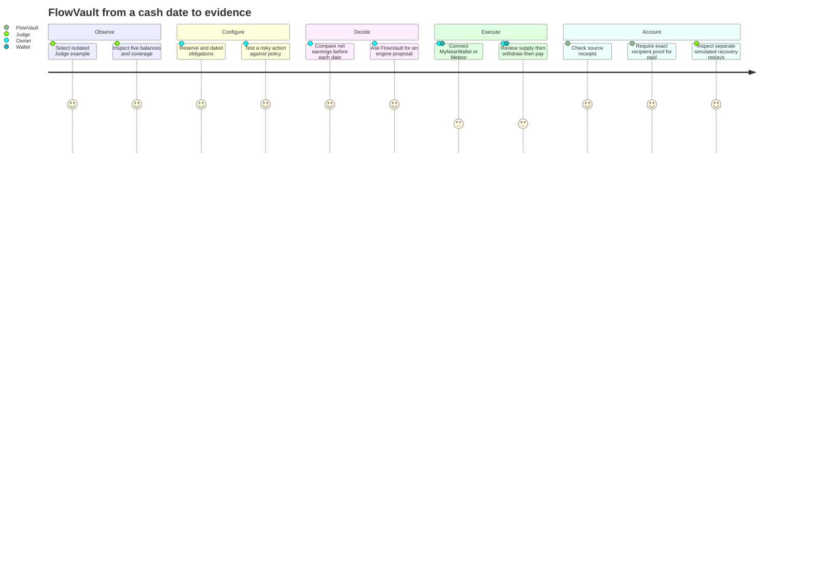
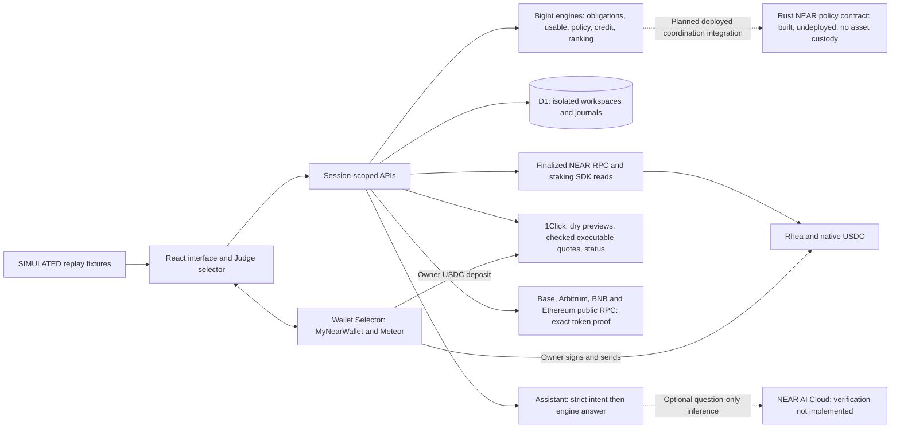
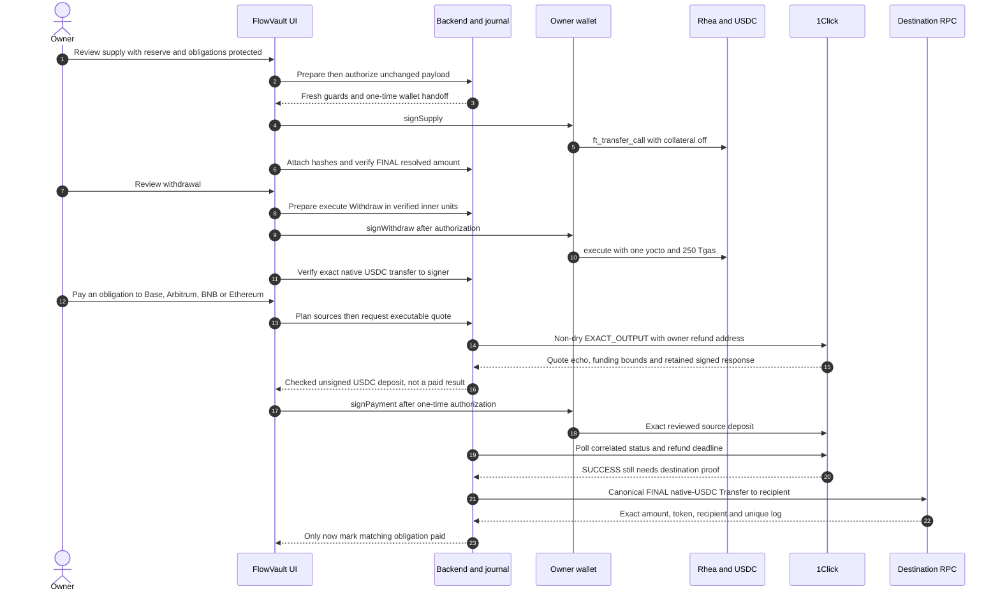
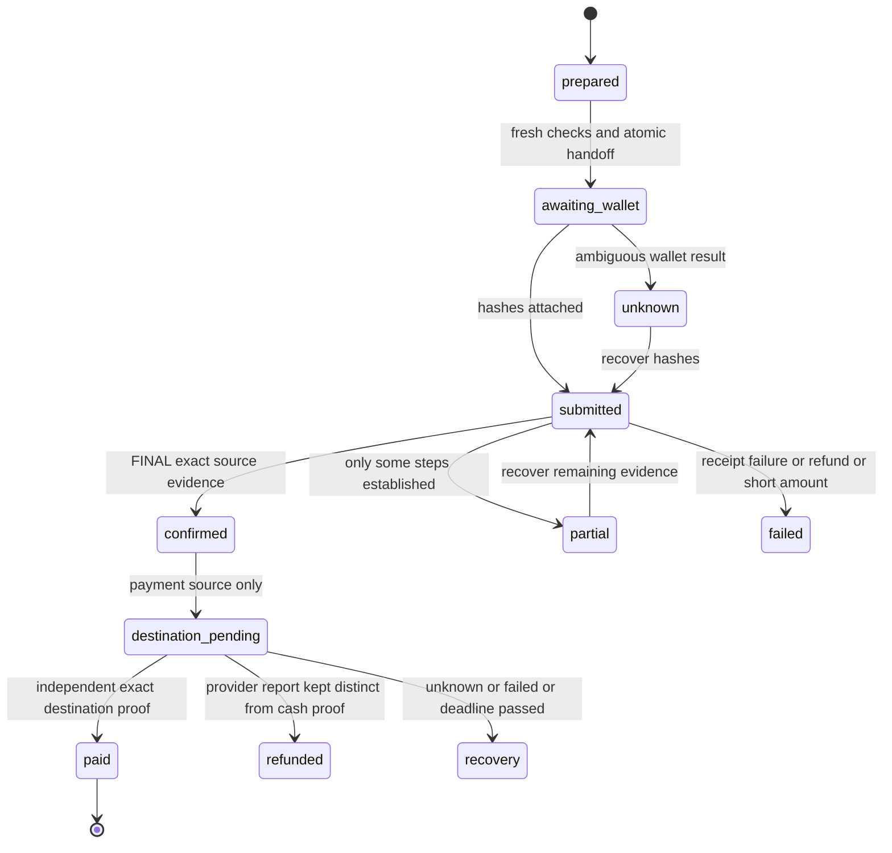
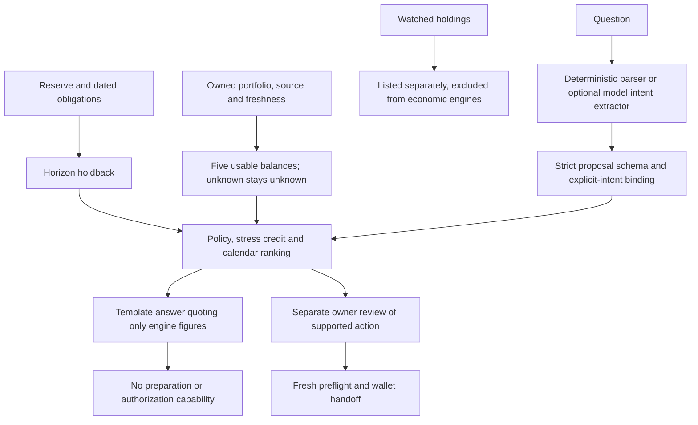
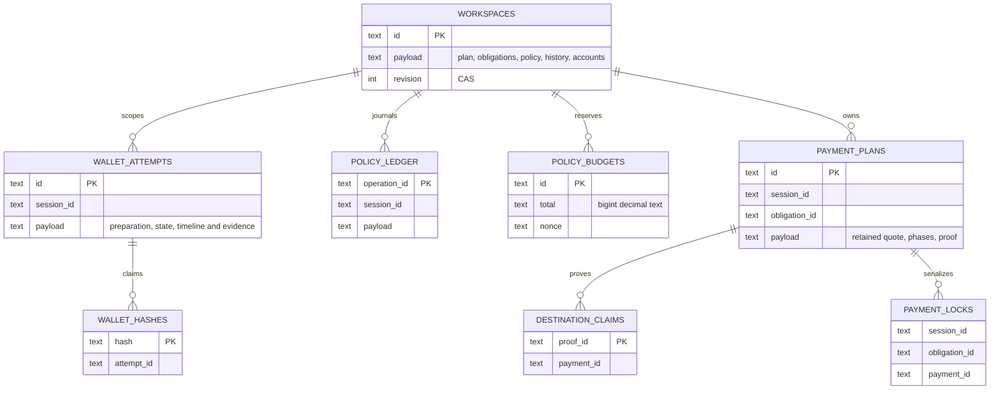
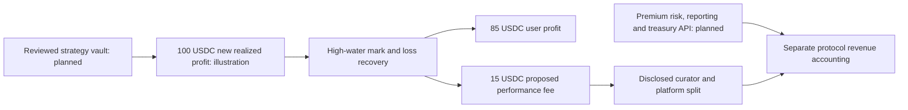
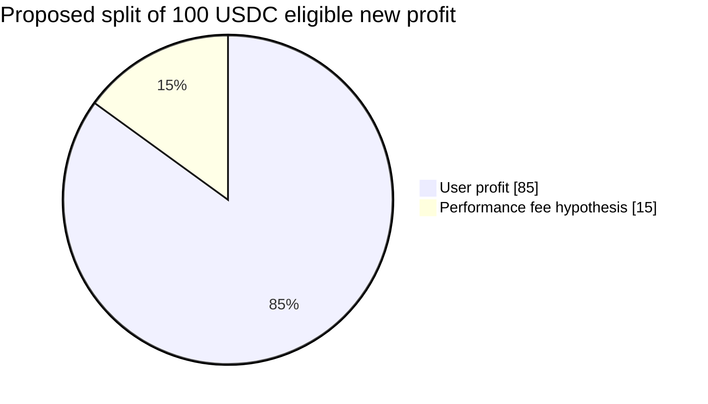
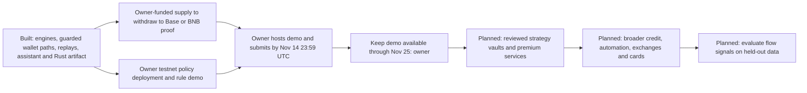

# FlowVault — capital, with a plan

**One portfolio, dated obligations, and rules that carry a cash decision through to a verified result.**

A portfolio tracker shows what you own. It does not tell you what can pay next week's rent without touching protected assets or missing an exit window. FlowVault separates net worth, cash, dated liquidity, stress capacity and committed capital; protects the reserve and bills; compares earning/funding choices; and verifies an owner-approved result.

Built on **NEAR**: Rhea USDC supply/withdrawal, NEAR Intents exact-output payment plumbing, native/LiNEAR/rNEAR reads, NEAR wallet signing, an optional NEAR AI Cloud intent parser, and a no-custody policy contract. **This checkout is a local Git repository with no remote; nothing has been published or deployed by the agents.** Funded end-to-end execution still needs the owner's rehearsal. The frontend is being wired separately; API availability is not a claim that every visual control is connected.

## Revamped workspace — 13 November 2026

The app opens on **Portfolio**. Navigation is **Portfolio · Markets · Swap · Earn · Borrow · Trade · Activity**, with **Send**, **Scheduled** and **Risk & permissions** directly available. Cmd/Ctrl+K searches pages and runs commands such as `swap 1 NEAR to USDC`, `buy RHEA` or a token symbol. Views link as `?view=markets`, `?view=swap`, `?view=earn`, `?view=borrow` and so on.

- **Swap** quotes Rhea / Ref and NEAR Intents as you type, ranks routes by output (exact, in token units) and shows balances, Max, USD values, rate and minimum received. Swaps between NEAR tokens run **inside FlowVault**: `/api/swap/execute` prepares the exact transactions (wrap, registrations, Ref `ft_transfer_call`, Ref's own unwrap for NEAR output), checks balances, storage and prices, and evaluates them against the owner's policy (a swap sells its input asset). The review card offers "Allow and continue", which saves a policy revision adding only that swap's venue and methods. The owner signs in their own wallet after `/api/transactions` authorize; receipts are verified (`swap-exec.ts`), and the result appears in Activity. **NEAR Intents routes also run in-app** (`swap-intents.ts`): from NEAR, Ethereum, Base or Arbitrum into the owner's own proven wallet on the destination network, FlowVault takes a live 1Click quote, checks balance, gas and policy, asks the wallet that holds the token to sign one deposit to the quote's deposit address, verifies that deposit on the origin chain, then records delivery or refund from 1Click's status. Balances come from every connected wallet, and sending/receiving addresses fill from the wallet that holds the token. Solana-origin routes still open the venue.
- **Markets** is a screener (DexScreener pairs: price, change, liquidity, volume, trades, market cap; NEAR markets, Trending, New; 5m–24h; chain filter; sorting; watchlist). Each token opens a page with GeckoTerminal candles, 24h flow, plain-language risk signals and a check against the owner's policy, plus Buy/Sell into Swap.
- **Earn** and **Borrow** open on live Rhea market tables (APY, totals, utilization, LTV). USDC rows lead into FlowVault's own supply and credit flows; other markets open Rhea.
- **Trade** has an always-visible order ticket (long/short, size, leverage, TP/SL, margin and estimated liquidation). Orders still go through the owner-configured Hyperliquid agent and signed mandate; the ticket shows which setup steps remain.
- **Portfolio** headline figures never go blank: partial reads show "≥ known subtotal", failed reads keep the last good figure with its time. A status bar shows portfolio, spendable cash, the next payment and guardrails.
- **Activity** adds the connected account's on-chain history (NearBlocks) beside FlowVault's journal.
- **Ask FlowVault** offers "Open swap" for swap-like questions; it only prefills the swap screen.
- Token and network logos are bundled in `public/assets`.

No deployment or owner-funded operation is implied. Perps execution needs the owner's agent key secret on the server.

## Run and see the pitch — no wallet or key required

Node **22.13+**, npm, and two terminals:

```sh
npm ci
npm run dev
```

Open **http://127.0.0.1:5173/**. In the second terminal:

```sh
npm run pitch-story
```

`pitch-story` drives the seeded example through HTTP, asserts consistency across endpoints, and prints each completed story beat. It never opens a wallet, requests a non-dry quote, calls a paid model, or changes personal state.

### Judge mode: do X, see Y

Select **Example workspace / Judge mode**. All example accounts, prices, rates and quantities are fictional. Dates stay relative to today's UTC date: the Nov 12 story becomes Nov 14 / Nov 23 / Nov 25 / Dec 1, and rolls forward on later days.

| Do this | See this |
| --- | --- |
| Open **Overview / Portfolio** | Net worth **25,526.48**, wallet USDC **15,190**, committed capital **8,201.76**, dated native-USDC liquidity **22,690**, and **54.54 illustrative** borrowing headroom against the example LSTs (no actual collateral or borrowing execution). Watched LP/NFT positions are excluded. |
| Open **Calendar / Policy** | Reserve **2,000** plus four obligations totaling **9,550** = **11,550** held back. Studio rent 2,500 USDC on Base (+2 days), Rent to Aman 1,000 USDT on BNB (+11), software 50 USDC on Arbitrum (+13), payroll 6,000 USDC to aman.near (+19). |
| Test a **6,000 USDC supply** | The **5,000 per-action cap** rejects it. The example's simulated daily usage is **1,250**, leaving **6,750** of its 8,000 daily cap. Testing an unsaved draft changes nothing. |
| Open **Plan to action / Strategies** | **2,690 USDC of NEAR-wallet surplus**; modeled liquid Rhea fits, while the higher-rate seven-day vault misses the first bill's exit window. Live unverified exits are excluded from automatic recommendations. |
| Open **Credit** and use the PRD scenario | 2,000 value −90% → **200** stressed; 70% cap → **140**; 80% liquidation threshold / 1.5 health → **106.666666** exact capacity, displayed **106.67**. Read-only; no loan is created. |
| Ask **“Pay Aman 1,000 USDT on BNB”** | Fictional idle-cash/Rhea source comparison with the reserve and ETH protected. BNB/USDT live routing is supported; this Judge result remains fictional planning, not a delivered payment. |
| Ask **“can I pay 1,000 USDT on BNB by Nov 23 without touching my ETH”** | A strict proposal, engine verdict and answer using only engine figures. No wallet payload, authorization or model-generated balance. |
| Open **Replays** | All five outcomes—success, refunded, partial, failed, deadline passed—for supply, withdraw and pay. Every record says **SIMULATED**, and cannot enter the live journal. |

The example's NEAR wallet has 14,240 USDC, Base 640, Arbitrum 310, Rhea supply 7,500, native stake/unstaking, LiNEAR/rNEAR, gas NEAR and protected ETH valued fictionally at 2,000. Example reservation assumes USDT = USDC; **live unknown FX is refused**. Economic cross-chain cash is not automatically spendable by the NEAR signer.

For API-driven screening, send `X-FlowVault-Workspace: example` or `?workspace=example` on session-backed requests. Personal and example workspaces have separate records, revisions, policies and journals; toggling Judge mode does not fence prepared personal actions. See [the API contract](docs/BACKEND_API.md) and [frontend handoff queue](docs/FRONTEND_REQUESTS.md).

## What is real, simulated, dry or planned?

| Evidence class | Implemented behavior | What it does not prove |
| --- | --- | --- |
| **Real public reads** | Finalized NEAR/Rhea views; Base/Arbitrum native-USDC RPC reads; native/LiNEAR/rNEAR lifecycle reads; explicit freshness and coverage. | Ownership, complete seven-chain coverage, or verified USD prices for every asset. Unknown is never silently zero. |
| **Implemented owner execution** | Mainnet MyNearWallet and Meteor helpers; guarded Rhea supply/withdrawal; exact-output 1Click deposit preparation/status/destination-proof code. | A funded FlowVault track record. The owner must sign each step; [funded rehearsal](docs/OWNER_RUNBOOK.md) remains required. |
| **Live dry quote** | `dry:true`, exact output, no deposit address or funds moved. Current sanitized minimum/fee observations are recorded. | A reserved executable route, permanent minimum, realized fee or successful payout. |
| **Fictional example** | Shared deterministic engines with clearly labeled fixture assets/rates/valuations and rolling dates. | Live holdings, returns, actual collateral capacity, or a funded execution. |
| **SIMULATED replay** | Sanitized recorded/derived provider schemas plus synthetic NEAR receipt fixtures; 15 disconnected scenarios. | Fifteen funded executions. IDs are non-signable and separate from live attempts. |
| **Built, undeployed contracts** | Rust policy contract (rules/proposals/approval/revocation, 14 tests) and the pooled vault contract (NEP-141 shares, queued deposits, FIFO claims, owner-only fee crystallization, trusted NAV, bounded Rhea authority, 42 tests); local WASM artifacts. | A deployed contract, real custody, a security audit or a verified outcome. Policy records say `unverified_record`. |
| **Read-only assistant / staking quote** | Strict intent schema, engine-only answer; verified SDK unsigned stake quotes with exit reserve. | Autonomous execution, cryptographically verified private inference, or a funded staking handoff. NEAR-to-USDC cap valuation remains gated. |
| **Implemented, not yet demonstrated (Phase 4)** | Cross-wallet funding, Solana USDC → NEAR, EVM fees in USDC, approved-asset sales, Aave v3 credit, autonomous mandates, Hyperliquid perpetuals and strategy vaults: code, tests and UI (see below). | Any funded, owner-signed or deployed run. The owner signs every step; see the owner actions below. |
| **Planned business/product** | Performance-fee revenue, premium automation and flow research are in the PRD. Card spending is deferred to a future phase. | Current fee revenue, forecast alpha, or a deployed pooled vault. |

A source deposit becoming `confirmed` does **not** mark a payment paid. `paid` requires a confirmed source deposit plus an independently checked canonical/finalized ERC-20 Transfer of the exact configured token amount to the recipient on Base/Arbitrum, BNB USDT or Ethereum USDC/USDT. Provider SUCCESS alone is insufficient. Refund reports, unknown status and source proof remain distinct.

## Phase 4 capabilities — 13 November 2026

Implemented code and tests; **nothing here has been funded, owner-signed or deployed**. Checks: 494 app tests, typecheck and build passed; 42 vault and 14 policy contract tests passed. Details: [`docs/PHASE4.md`](docs/PHASE4.md), [`docs/BUILD_STATUS.md`](docs/BUILD_STATUS.md), [`docs/BACKEND_API.md`](docs/BACKEND_API.md).

| Capability | What the code does | Where | Owner action before it is real |
| --- | --- | --- | --- |
| Cross-wallet orchestration | Funds a plan from one or several proven wallets (cheapest single vs mixed after costs), one wallet approval per leg, per-leg ledger and recovery, no atomicity claim | Plan panel | rehearse with their own wallets |
| Solana USDC → NEAR | SPL transfer rebuilt and checked in the browser, signed in Phantom/Solflare, delivered through 1Click | Convert to NEAR | rehearse with a Solana wallet |
| EVM fees in USDC | Circle Paymaster through the wallet's own call batching; only the reviewed transfer is sponsored; ETH stays the default | Convert to NEAR | HTTPS deployment + an ERC-7677 wallet |
| Approved-asset sales | Sells only assets the policy allows, sized for exact net USDC, refund-aware | Credit | sale rows in policy; a signed sale |
| Broader lending | Rhea and Aave v3 (Ethereum, Base, Arbitrum) with venue-local stressed capacity and a settlement proof gate | Credit | allow the venues in policy; a signed borrow/repay |
| Autonomous mandates | Signed terms, deterministic checks, scheduled runs that prepare owner-signed plans; optional custody through a single-depositor vault | Policy | sign/activate; for custody, deploy a vault, provision a scoped key, set `FLOWVAULT_CUSTODY_SIGNERS` |
| Perpetuals (Hyperliquid) | Trade-only agent under a signed mandate; unrealized gains never count as cash | Strategies | set `FLOWVAULT_AGENT_KEY_SECRET`, sign `approveAgent`, deposit on Hyperliquid |
| Strategy vaults | NEAR vault contract plus holder/owner views and wallet-signed deposit, redeem, cancel, claim and settle | Strategies | deploy and register the vault, file NAV reports, allow it in policy, security review |
| Card spending | Deferred by the owner | — | — |

## NEAR features by submission track

These describe technical fit, not a claim of eligibility or an award.

| Track | Concrete NEAR contribution | Boundary / demonstration needed |
| --- | --- | --- |
| **defi** | Rhea native-USDC supply/withdrawal, reserve protection, calendar-aware net ranking, staking lifecycle and stress preview. | Owner-funded receipts; no borrow execution or guaranteed returns. |
| **realworld** | Dated payroll/rent and NEAR Intents EXACT_OUTPUT settlement to Base/Arbitrum, BNB USDT and Ethereum USDC/USDT. | L1 funded source-to-recipient proof; All funded route evidence remains owner-required; Judge results are labelled fictional. |
| **security** | Bigint units, policy caps/allowlists, revisions, signer binding, one-time handoff, refund and exact-outcome checks; Rust NEAR policy contract. | Contract is undeployed; an on-chain rule demonstration and external review remain owner steps. |
| **agents** | Natural-language proposals are schema-validated and evaluated by deterministic engines; contract supports registered agent proposals/revocation. | No unattended trading, deployed agent key or live contract integration is claimed. |
| **privacy** | Optional server-only NEAR AI Cloud extraction; sends question/date/schema, not stored balances or accounts; exact data sent is visible. | No real-key inference was run in automated checks. Attestation, response signatures and E2EE are **not verified** by this app. |
| **open** | MIT-authored source, retained Apache/MIT notices, public read adapters, auditable local engines and reproducible pitch tests. | A public repository and hosted demo are the owner's publication actions. |

## Verification and owner operations

With the dev server running:

```sh
npm test
npm run typecheck
npm run build
npm run smoke
npm run pitch-story
node tests/design-api-smoke.mjs
node tests/mechanics-smoke.mjs
```

`smoke` includes a public Rhea market read; a public-RPC outage fails that check honestly. The story/design/mechanics suites use fresh isolated example sessions and no funded wallet. Amounts use bigint base units (USDC six decimals, NEAR 24, Rhea inner precision read explicitly).

Optional Rust checks:

```sh
cargo test --locked --manifest-path contracts/policy/Cargo.toml
cargo build --locked --manifest-path contracts/policy/Cargo.toml --target wasm32-unknown-unknown --release
```

- [Owner funded-camera runbook](docs/OWNER_RUNBOOK.md): fresh minimum checks, supply → withdrawal → exact-output Base payout, Activity evidence and recovery.
- [Cloudflare hosting runbook](docs/CLOUDFLARE_DEPLOY.md): owner-created D1, server secrets, prepared config and owner-run deployment. Nothing is deployed by these docs.
- [Submission audit](docs/SUBMISSION_AUDIT.md): MIT/Apache notices, ASGARD checks, Git hygiene, secret scan and diagram validation.
- [Build status](docs/BUILD_STATUS.md): actual verification and remaining owner-only checks.

The local D1/cookie model is development-session isolation, **not production identity/authentication**. No private wallet key is collected by the backend. The owner wallet signs and sends; the agent never signs, spends, deploys or publishes. Staking preparation is a non-signable quote until valuation/cap checks and a funded handoff are implemented.

## Revenue model — proposed, not charged

PRD §9.1 proposes **15% performance / 0% management** as an initial vault pricing hypothesis, with high-water marks/loss recovery and explicit curator/platform splits. Additional planned modules are premium risk/reporting/bounded automation, disclosed execution services, and treasury/API/SDK distribution partnerships. No FlowVault performance, subscription or routing fee is configured in this build; 1Click/provider costs are separate.

For illustration only: 100 USDC of new eligible realized profit above a high-water mark would split into 15 fee / 85 user profit under that hypothesis. Future fee revenue, user NAV, reward tokens and speculative incentives must remain separate. No emissions, token appreciation or historical PnL are used as revenue evidence. See [the product requirements](docs/PRODUCT.md#91-revenue-modules).

## Diagrams

These describe the current code boundary. Dashed edges and labels identify owner-only or planned integration. Diagram syntax is checked with pinned Mermaid; diagrams are not funded-execution evidence.

### 1. User journey



### 2. System architecture



### 3. Transfer cycle: supply, withdraw and exact-output pay



### 4. Wallet attempt and payment lifecycles



Supply/withdrawal `confirmed` completes that source operation. A payment's source `confirmed` does not mean recipient `paid`. Local draft review is a separate non-signing state machine; SIMULATED replays never enter either live path.

### 5. Data flow and assistant authority boundary



### 6. Storage model



### 7. Concrete revenue use case — illustrative future vault





### 8. Roadmap and proof gates



## Licensing and submission boundary

FlowVault-authored source is **MIT**, chosen by the owner. NearAnyStake adaptations and schema derivatives retain Apache-2.0 attribution/license and the [NOTICE](NOTICE); AllPilot references retain MIT notices. ASGARD is unlicensed, ideas only: no ASGARD product code is imported. [THIRD_PARTY.md](THIRD_PARTY.md) and [provenance](docs/reference-provenance.json) identify reused material. The older Chainlink FlowVault is conceptual background; its contracts/keys/code were not copied here.

Git is initialized locally with **no remote and no commit**. Private local D1 state, environment files, credentials, reference clones and personal live captures are ignored. Publication, first commit, funded signing, deployment, X demo post and final submission remain owner actions. This README does not claim they happened.
